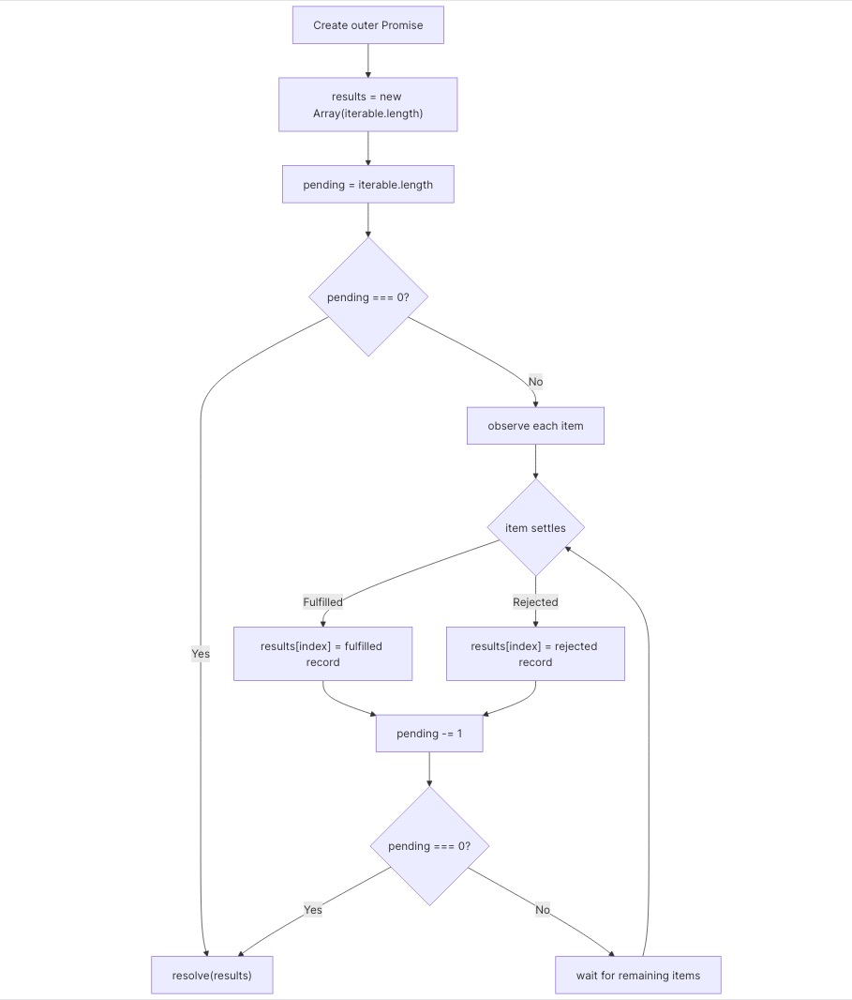

## Promise.allSettled (Official solution)

**Note:** Complete the [`Promise.all`](https://www.greatfrontend.com/questions/javascript/promise-all) question first.

`Promise.allSettled()` never short-circuits: fan out every input, collect every outcome, then resolve once the whole batch has settled. Rejections are converted into result objects instead of being routed to the outer promise.

## Solution

The code only needs three tasks:

- `results`: a pre-sized array for the final outcome objects.
- `pending`: how many inputs have not settled yet.
- One per-item settlement handler that writes to `results[index]`.

The ordering rule is the important part: completion order does not matter because each input writes back to its original index. Once `pending` reaches `0`, the outer promise resolves with the completed `results` array. If the input is empty, there are no pending items, so the outer promise resolves with an empty array.

This also explains why the outer promise never rejects. Each input handles both success and failure internally and converts them into one of these shapes:

- If a value is resolved, the outcome object has the `{ status: 'fulfilled', value }` shape.
- If a value is rejected, the outcome object has the `{ status: 'rejected', reason }` shape.

Plain values are fine too. `await item` or `Promise.resolve(item)` normalizes promises and non-promises into the same flow. The key difference from `Promise.all()` is that the rejection handler stores a rejected outcome and still decrements `pending`; it does not call the outer `reject`.

The counter update belongs on both branches. If fulfillment decrements `pending` but rejection only records a reason, the outer promise can wait forever even though every input has already settled.

If inputs settle in a different order from how they were provided, index assignment preserves the final order:

| Input index | Settles when | Outcome written to                       |
| ----------- | ------------ | ---------------------------------------- |
| `2`         | First        | `results[2]`                             |
| `1`         | Second       | `results[1]`                             |
| `0`         | Last         | `results[0]`, then `pending` reaches `0` |



```ts
interface PromiseFulfilledResult<T> {
  status: 'fulfilled';
  value: T;
}
interface PromiseRejectedResult {
  status: 'rejected';
  reason: any;
}
export default function promiseAllSettled<T>(
  iterable: Array<T>
): Promise<Array<PromiseFulfilledResult<T> | PromiseRejectedResult>> {
  return new Promise((resolve) => {
    // Every input contributes a settled record, so resolve only after all of them finish.    const results = new Array(iterable.length);    let pending = iterable.length;
    if (pending === 0) {
      resolve(results);
      return;
    }
    iterable.forEach(async (item, index) => {
      try {
        const value = await item;
        results[index] = { status: 'fulfilled', value };
      } catch (err) {
        results[index] = { status: 'rejected', reason: err };
      }
      pending -= 1;
      if (pending === 0) {
        resolve(results);
      }
    });
  });
}
```

### Alternative: Use `Promise.resolve(...).then(...)`

This version uses explicit promise chaining instead of `async`/`await`, but the state layout is exactly the same. The `.finally()` step is a useful way to keep the counter update shared by the fulfilled and rejected branches.

```tsx
interface PromiseFulfilledResult<T> {
  status: 'fulfilled';
  value: T;
}
interface PromiseRejectedResult {
  status: 'rejected';
  reason: any;
}
export default function promiseAllSettled<T>(
  iterable: Array<T>
): Promise<Array<PromiseFulfilledResult<T> | PromiseRejectedResult>> {
  return new Promise((resolve) => {
    // Every input contributes a settled record, so resolve only after all of them finish.    const results: Array<PromiseFulfilledResult<T> | PromiseRejectedResult> =      new Array(iterable.length);    let pending = iterable.length;
    if (pending === 0) {
      resolve(results);
      return;
    }
    iterable.forEach((item, index) => {
      Promise.resolve(item)
        .then(
          (value) => {
            results[index] = { status: 'fulfilled', value };
          },
          (reason) => {
            results[index] = { status: 'rejected', reason };
          }
        )
        .finally(() => {
          pending -= 1;
          if (pending === 0) {
            resolve(results);
          }
        });
    });
  });
}
```

## Common pitfalls

- Rejecting the outer promise on the first rejection turns the helper into `Promise.all()`.
- Pushing outcome objects records settlement order, not input order. Assign by index instead.
- Forgetting to decrement `pending` for rejected inputs can leave the outer promise pending forever.
- Treating plain values as invalid misses that non-promise values should become fulfilled outcomes.
- Running inputs sequentially is unnecessary; each input can be wired up immediately and settle independently.
- Empty input should resolve to `[]`.
- Non-`Promise` values should still appear as fulfilled outcomes.

## Techniques

- Knowledge of `Promise`s, how to construct one, and how to use them.
- Async programming.

## Notes

- The evaluator does not verify whether the implementation settles inputs concurrently or sequentially, but `Promise.allSettled()` is normally expected to wire them up concurrently.
- The constructor does not need an outer `reject` path because every input rejection is captured as data in the `results` array.

## Resources

- [Promise.allSettled() - JavaScript | MDN](https://developer.mozilla.org/en-US/docs/Web/JavaScript/Reference/Global_Objects/Promise/allSettled)
