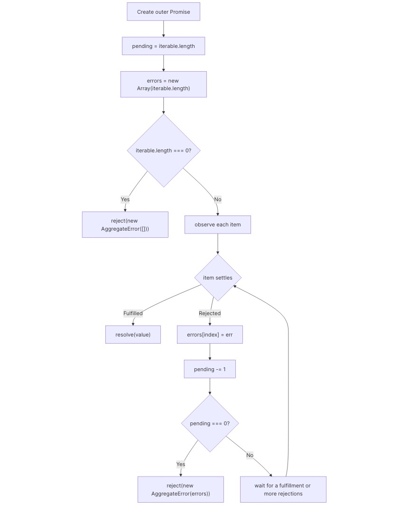

## Promise.any

After implementing [`Promise.all`](https://www.greatfrontend.com/questions/javascript/promise-all), this is a useful contrast: `Promise.any` resolves on the first fulfillment and rejects only if every input rejects.

## Solution

Think of it as "race to fulfill, collect failures just in case". The outer promise settles as soon as any input fulfills. Individual rejections are not final until every input has rejected.

The code needs to preserve these rules:

1.  Return a new `Promise` immediately.
2.  Reject an empty input with `new AggregateError([])`.
3.  Resolve as soon as the first input fulfills.
4.  If every input rejects, reject with `AggregateError(errors)` where `errors` stays in input order.
5.  Handle both promises and plain values.

The main correctness rule is tracking how many inputs still need to reject before the outer promise can reject. That is why the code keeps both:

- an `errors` array indexed the same way as the input, and
- a `pending` counter that only reaches `0` once every item has rejected.

That counter matters. `errors.length` is not enough because assigning `errors[2]` also grows the array length even if earlier promises are still pending. Completion order also does not determine the `AggregateError` order; each rejection reason is stored at its original index.

Plain values should be treated like already-fulfilled promises. In the `async` version, `await item` normalizes them. In the `.then()` version, `Promise.resolve(item)` does the same and also assimilates thenables.



```ts
/** * @param {Array} iterable * @return {Promise} */
export default function promiseAny(iterable) {
  return new Promise((resolve, reject) => {
    if (iterable.length === 0) {
      reject(new AggregateError([]));
    }
    let pending = iterable.length; // Keep rejection reasons by input index so the AggregateError matches the iterable order.
    const errors = new Array(iterable.length);
    iterable.forEach(async (item, index) => {
      try {
        const value = await item;
        resolve(value);
      } catch (err) {
        errors[index] = err;
        pending--;
        if (pending === 0) {
          reject(new AggregateError(errors));
        }
      }
    });
  });
}
```

An alternative version can use `.then()` directly instead of `async`/`await`. The control flow is the same: fulfillment resolves the outer promise immediately, rejection records the reason and only rejects the outer promise when `pending` reaches `0`.

```ts
export default function promiseAny<T>(iterable: Array<T>): Promise<T> {
  return new Promise((resolve, reject) => {
    if (iterable.length === 0) {
      reject(new AggregateError([]));
    }
    let pending = iterable.length; // Keep rejection reasons by input index so the AggregateError matches the iterable order.
    const errors = new Array(iterable.length);
    iterable.forEach((item, index) =>
      Promise.resolve(item).then(
        (value) => {
          resolve(value);
        },
        (reason) => {
          errors[index] = reason;
          pending--;
          if (pending === 0) {
            reject(new AggregateError(errors));
          }
        }
      )
    );
  });
}
```

## Common pitfalls

- Rejecting on the first rejection implements `Promise.race()`, not `Promise.any()`.
- Using `errors.length` to decide when to reject is incorrect for sparse arrays.
- Pushing errors records rejection order, not input order. Assign by index instead.
- Treating an empty input as forever pending is `Promise.race()` behavior; `Promise.any([])` rejects with an `AggregateError`.
- Awaiting inputs sequentially can delay a later fulfillment that should have won.

## Scope

- Empty input array. The returned promise should reject with an `AggregateError`.
- Non-promise values should be treated like already-fulfilled promises.

## Techniques

- Constructing promises
- Concurrent async coordination
- Preserving input order for aggregated errors

## Notes

- The important correctness check is whether all inputs have rejected, not whether the `errors` array happens to have a matching length.
- The evaluator does not verify whether the solution starts all input work concurrently, but a correct `Promise.any` implementation should.

## Resources

- [Promise.any() - JavaScript | MDN](https://developer.mozilla.org/en-US/docs/Web/JavaScript/Reference/Global_Objects/Promise/any)
