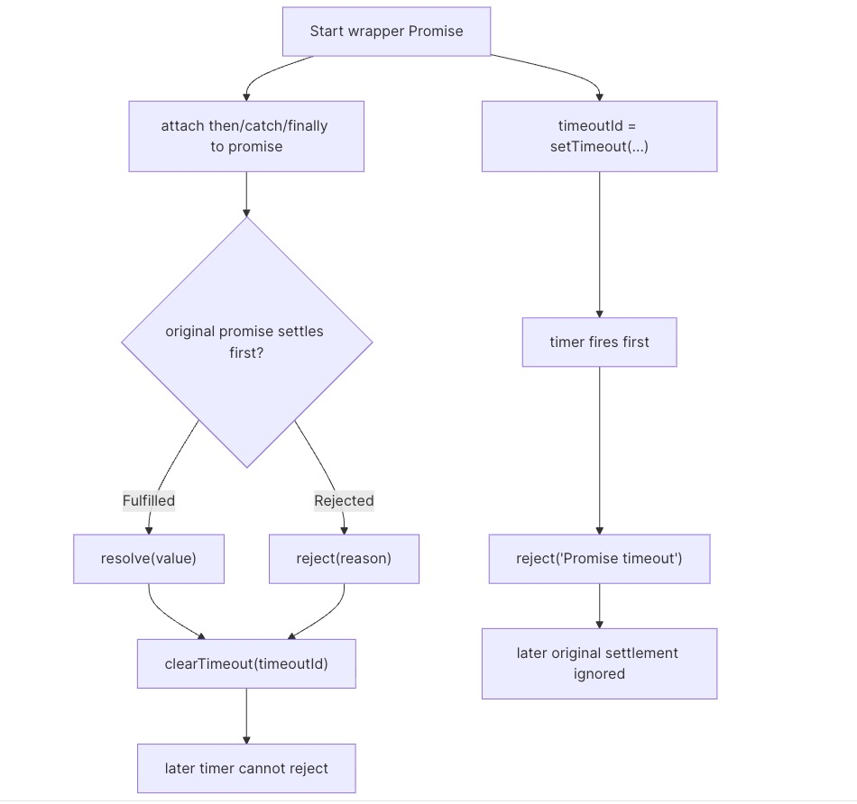

# Promise Timeout - Solution

## Solution

`promiseTimeout()` is a small proxy promise with two possible winners. It is tempting to only handle fulfillment, but the wrapper must mirror whichever original settlement happens before the timer, including rejection.

## Solution

- The original `promise` settles before the deadline.
- The timer reaches `duration` first.

If the original promise wins, the returned promise mirrors its settled value. This includes both fulfillment values and rejection reasons. If the timer wins, the returned promise rejects with the exact string `'Promise timeout'`.

The direct implementation creates a wrapper `Promise` and wires both outcomes into it:

1.  Start a `setTimeout()` that rejects the wrapper after `duration`.
2.  Pipe the original promise's fulfillment into `resolve`.
3.  Pipe the original promise's rejection into `reject`.
4.  Use `.finally()` to clear the timer when the original promise settles.

Native promises already enforce the "settle once" rule, so whichever branch resolves or rejects the wrapper first determines the final result. Clearing the timeout matters when the original promise wins: it prevents the timer from firing later and attempting to reject a promise that has already settled.



## Solution

```tsx
export default function promiseTimeout<T>(promise: Promise<T>, duration: number): Promise<T> {
  return new Promise((resolve, reject) => {
    const timeoutId = setTimeout(() => {
      reject('Promise timeout');
    }, duration);
    promise
      .then(resolve)
      .catch(reject)
      .finally(() => {
        clearTimeout(timeoutId);
      });
  });
}
```

### Using `Promise.race()`

The same idea can be written more directly by turning the timeout into a promise and racing the two. `Promise.race()` settles with whichever promise settles first, so it naturally forwards either the original promise's settled value or the timeout rejection.

```tsx
export default function promiseTimeout<T>(promise: Promise<T>, duration: number): Promise<T> {
  const timeout = new Promise((_, reject) => {
    setTimeout(() => {
      reject('Promise timeout');
    }, duration);
  });
  return Promise.race([promise, timeout]) as Promise<T>;
}
```

This version is concise, but it does not keep the timeout id around for cleanup. If the original promise settles first, the timeout promise is still scheduled and will reject later. That later rejection does not change the returned promise's result, but the direct implementation is preferable when cleanup matters.

The interview rule is: the returned promise is a mirror until the deadline, then a timeout rejection after the deadline. It is not a cancellation primitive for the original promise.

## Common pitfalls

- **Only handling fulfilled promises:** The original promise can reject before the timeout. In that case, the returned promise should reject with the original rejection reason, not with `'Promise timeout'`.
- **Rejecting synchronously for `duration` of `0`:** `setTimeout(callback, 0)` still schedules a timer. If the original promise is already resolved, or if its own `0`ms timer was registered before the timeout timer, the original promise can still win. Do not special-case `0` by rejecting synchronously.
- **Forgetting timeout cleanup:** If the original promise settles first, clear the timeout. Later calls to `resolve` or `reject` would be ignored by the wrapper promise, but leaving the timer scheduled creates unnecessary work and can keep the process alive longer than needed.

## Notes

- `promiseTimeout()` does not cancel the underlying async operation. If the timeout wins, the original promise may still settle later; its result is just ignored by the returned promise.
- The timeout rejection value is the string `'Promise timeout'`.
- The helper assumes the first argument is a `Promise`, as shown in the function signature.
- The direct implementation mirrors both fulfillment and rejection from the original promise; the timeout is only a fallback settlement path.
